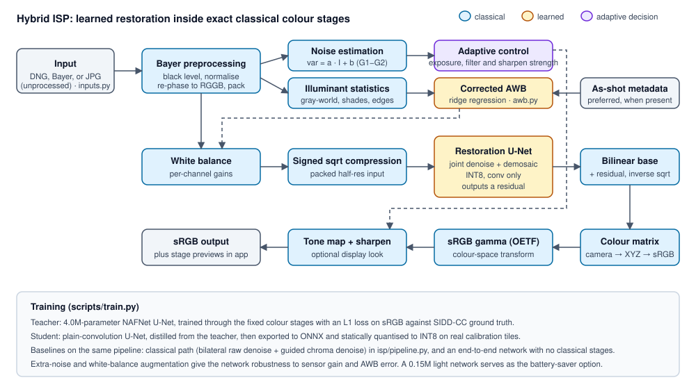

# Hybrid Smartphone ISP (Hackathon P2)

A learned, computationally efficient smartphone ISP: noisy RAW in, finished sRGB out. A 0.95M-parameter INT8 network does
denoising and demosaicing, inside exact classical stages for white balance, colour and gamma. The model is under 1 MB.



## Results

Blind test on all 928 unseen SIDD-CC blocks (white balance estimated). Latency is one 512 × 512 raw tile on 2 CPU threads.
Full tables: `eval_P2_*.md`. The end-to-end model shares the teacher architecture, so the teacher latency applies to it.

| Pipeline | PSNR (dB) | SSIM | ΔE2000 | LPIPS | Parameters | Size (MiB) | ms/tile |
|---|---|---|---|---|---|---|---|
| Classical ISP | 33.38 | 0.867 | 3.94 | 0.267 | 0.00M | 0.00 | 39 |
| Learned end-to-end, FP32 | 35.03 | 0.906 | 3.66 | 0.175 | 4.02M | 15.53 | 218 |
| Hybrid teacher, FP32 | 35.70 | 0.922 | 3.42 | 0.164 | 4.02M | 15.53 | 218 |
| **Hybrid student, INT8 (deployed)** | 35.23 | 0.913 | 3.61 | 0.129 | 0.95M | 0.98 | 15 |

With the true white balance, the deployed model reaches 38.61 dB, so colour estimation is the main remaining error.

## Run it

```bash
pip install -r requirements.txt
python app.py
```

Then open http://localhost:7860. Or with Docker:

```bash
docker build -t hybrid-isp .
docker run -p 7860:7860 hybrid-isp
```

The app accepts DNG and other Bayer camera RAW, `.npy` Bayer mosaics, and JPG/PNG (converted to simulated RAW). It runs on CPU
and needs no secrets.

## Reproduce the results

Needs an NVIDIA GPU and about 40 GB of disk. Training takes about 6 hours on an RTX 4060 Laptop GPU.

```bash
pip install -r requirements-train.txt
bash scripts/run_all.sh
python scripts/sweep_quant.py
python scripts/evaluate.py main
python scripts/evaluate.py ablation
python scripts/evaluate.py robustness
python scripts/evaluate.py failures
python scripts/benchmark.py
python scripts/make_report.py --team <TeamID> --usns <USN1,USN2,...>
```

Training seeds are not fixed, so a re-run will differ slightly. Checkpoints (`.pt`) are not in the repository; the deployed ONNX
models are in `weights/`. Run the checks with `python -m pytest tests`.

## Layout

| Path | Purpose |
|---|---|
| `app.py` | Gradio interface |
| `isp/classical.py` | Classical stages: demosaic, WB, CCM, gamma, denoise, tone map, sharpen |
| `isp/pipeline.py` | Classical, learned and hybrid ISPs |
| `isp/models.py` | Teacher, student and differentiable colour stages |
| `isp/awb.py` | Corrected white balance |
| `isp/engine.py`, `isp/inputs.py` | Runtime and file handling |
| `scripts/` | Data, training, export, evaluation, publishing |
| `docs/DESIGN.md` | Design document, limitations and ethics |
| `docs/FAILURES.md` | Failure-case analysis |
| `docs/VIVA.md` | Viva guide |

## Limitations

White balance is the main source of error, the end-to-end baseline is close on blind accuracy, latency is measured on a laptop
CPU rather than a phone, and SIDD covers only five phones and ten scenes. See `docs/DESIGN.md` section 10.

## Credits

Data: SIDD-CC (Mohammadi et al. 2026) and SIDD (Abdelhamed, Lin, Brown, CVPR 2018), under the SIDD terms of use.
