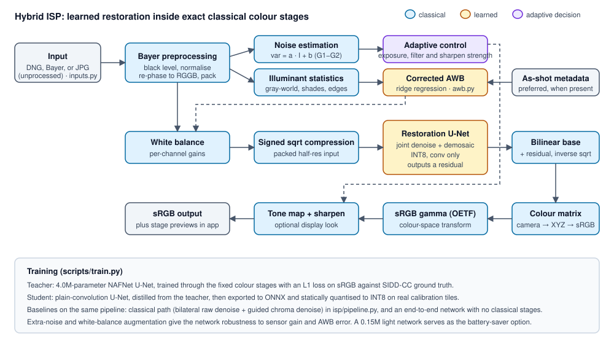

# Design document: Hybrid Smartphone ISP (P2)

## 1. Problem and goals

A phone sensor delivers a noisy, mosaiced, colour-cast RAW frame. The ISP must turn it into a clean sRGB image
under tight compute, memory and power limits. P2 asks for a learned RAW-to-RGB pipeline that improves on a
conventional ISP while staying efficient.

Goals: beat a classical ISP on PSNR, SSIM, ΔE and LPIPS on unseen data; keep colour accurate; fit mobile limits
(about 1 MB model, sub-second 12 MP on two CPU threads); and show robustness and failure behaviour honestly.

## 2. Data

**SIDD-CC** (Mohammadi et al. 2026), a re-processing of SIDD (Abdelhamed et al. 2018), the dataset named in the
brief. The official SIDD server was unreachable, and SIDD-CC offers re-estimated ground truth and a clean split.

| Split | Content | Used for |
|---|---|---|
| Train | 204 image pairs, scenes other than 008 | Training, AWB fit, INT8 calibration |
| Validation | 26 pairs, all of physical scene 008, five cameras | Every model and setting choice |
| Test | 928 blocks of 256 px from 29 instances | Final reporting |

Cameras: Google Pixel, iPhone 7, Galaxy S6 Edge, Nexus 6, LG G4. ISO 50 to 10,000, three illuminants. Only noisy RAW
and clean sRGB are used for training. Test blocks ship without metadata, so the camera is inferred from frame
shape, and white balance and noise are estimated from each scene's blocks.

## 3. Key finding that shaped the design

Fitting clean RAW against clean sRGB showed the ground truth is almost exactly
`sRGB_OETF(M · demosaic(raw))`, with `M = XYZ→sRGB · normalised(cam→XYZ) · diag(1 / neutral)`. Using metadata alone,
this formula reproduces the target at 51.3 dB on a full image. Colour is therefore known maths. The hard parts are
denoising, demosaicing and estimating the neutral. So the network does restoration only, and colour stays classical.

## 4. Architecture

| Stage | File | Type |
|---|---|---|
| Decode, black level, normalise, RGGB re-phase, pack | `isp/inputs.py`, `isp/classical.py` | Classical |
| Noise fit `var = a·I + b` from the G1−G2 difference | `classical.estimate_noise` | Classical |
| White balance: as-shot if present, else corrected AWB | `isp/awb.py` | Classical + ridge |
| Denoise + demosaic residual U-Net | `isp/models.py`, `pipeline.Restorer` | Learned |
| Colour matrix, sRGB gamma | `classical.cam_to_srgb`, `srgb_oetf` | Classical |
| Tone curve, sharpening (display look) | `classical.tone_map`, `sharpen` | Classical |

### Classical ISP (baseline)

Generalised Anscombe transform, then a bilateral filter per Bayer plane; bilinear or Malvar demosaic; guided-filter
chroma denoise whose radius follows noise; then the same colour stages. Filter strength was tuned on validation
(`scripts/tune_classical.py`). Bilinear is the default because it matches the ground-truth renderer (Malvar scored
40.4 dB against bilinear's 51.3 dB on clean RAW).

### Learned ISP (baseline)

The teacher-sized network with no white balance or colour matrix: compressed Bayer in, sRGB out. It must learn colour
implicitly and cannot use metadata.

### Hybrid ISP (this work)

The network sees white-balanced packed Bayer under a signed square root, which spreads dark values and keeps
activations in a range that suits INT8. It predicts a residual over a bilinear demosaic. In training, gradients flow
through the fixed colour matrix and gamma, so an L1 loss on final sRGB pays for what viewers see, while the network
cannot change colour rendering.

- **Teacher:** NAFNet-style U-Net, 4.02M parameters.
- **Student (deployed):** plain convolution + ReLU U-Net, 0.95M parameters, distilled from the teacher.
- **Light student:** 0.15M parameters, the app's battery-saver option.

### White balance

Corrected-moments style ridge regression on log-chromaticities of gray-world, shades-of-gray, bright-pixel and
gray-edge statistics, with per-camera terms. Ridge strength came from leave-one-scene-out cross-validation.
Validation error is 3.10° against 5.32° for gray-world; test error is 2.61° against 5.46°. Adding chromaticity
histograms or tree models gained under 0.2°, so the simpler model stayed. The labels are themselves camera AWB output.

## 5. Adaptive behaviour

Measured noise and brightness drive classical denoise radius, sharpening strength (less when noisy) and exposure gain
in the display look. The network adapts implicitly, since it was trained across ISO 50–10,000 with extra-noise
augmentation.

Two adaptive ideas were tested and rejected because the data did not support them:

- **Noise planes as network input.** On validation they cost 1.4 dB for the small student (33.74 vs 35.15 dB) and
  0.74 dB for the full student (36.63 vs 37.37 dB). On test the effect is small (34.81 vs 34.95 dB). A likely reason
  is that per-image noise values let the network identify training images, but this was not proven.
- **Routing quiet scenes to the light network.** The light network trails by 1.2–2.6 dB in every noise bin
  (`results/route.json`), so no threshold is justified. It is a user choice instead.

## 6. Optimisation

| Technique | Effect |
|---|---|
| Knowledge distillation | 4.0M to 0.95M parameters, 36.3 to 11.8 GMAC per MP |
| INT8 static quantisation (QDQ, per-channel) | 3.6 to 0.98 MiB, about 2× faster than FP32 on CPU |
| FP16 | Half the file size; no CPU speed-up, since it lacks native kernels here |
| Light network | 0.19 MiB, 2.5 GMAC per MP |

Plain min-max INT8 lost about 2 dB to activation outliers. `scripts/sweep_quant.py` picks the setting on validation
across clean, noisy and underexposed input. The 99.9th-percentile clip with the first and last convolutions left in
float won (mean 34.09 dB, FP32 34.19 dB). A 99.5 clip looked better on clean input but clipped noisy activations, costing
1.8 dB on test at −2 EV, which is why degraded input is part of the criterion.

## 7. Training

Random 256 px RGGB-phase crops with phase-preserving flips, 30% extra Poisson-Gaussian noise, ±12% white-balance jitter
that the renderer undoes. AdamW, cosine schedule, peak LR 1e-3, batch 16, bf16 on an RTX 4060 Laptop GPU. Teacher 40k
iterations, student 40k, end-to-end 20k, ablations 12k each. Distillation loss is L1 in compressed space with weight 1.
The 8-pixel border is left out of the loss, so inference reflect-pads by 18 pixels (even, to keep CFA phase) and
crops back. Without this, border errors cost 4.3 dB on average on 256 px blocks (34.73 vs 39.02 dB with true white balance on a test subset); per-scene analysis exposed it.

## 8. Evaluation

All numbers and tables are in the `eval_P2_*.md` file, generated by `scripts/make_report.py` from `results/*.json`.
Metrics: PSNR, SSIM, CIEDE2000 and LPIPS (AlexNet), plus parameters, size, GMAC, latency and peak memory.

## 9. Ablation and failures

Ablations are in the eval file. The largest single effects: removing both classical denoisers loses 7.8 dB in the
classical path; replacing corrected AWB with gray-world loses 3.7 dB; removing learned restoration loses 1.6 dB and
0.038 SSIM. Distillation and augmentation show smaller effects on test than on validation. See `FAILURES.md`.

## 10. Limitations

- **White balance is the main limit.** Blind PSNR is about 3.4 dB below PSNR with the true neutral. In practice phones
  supply as-shot values, but SIDD-CC test metadata is unavailable, so the oracle rows use values recovered from
  ground truth and are diagnostics only.
- **The end-to-end baseline is close in blind accuracy** (35.03 dB at FP32 vs 35.23 dB at INT8). The hybrid's advantages
  are 4× fewer parameters, about 15× lower latency, use of metadata and inspectable stages, not a large blind PSNR lead.
- **Test scenes are not fully new.** SIDD has only 10 physical scenes, so test captures share scenes with training.
  Validation scene 008 is the only fully unseen scene, and it scored 37.37 dB with true white balance.
- **Test-set exposure.** Debugging used test blocks: the border bug, and a first look at INT8 and noise planes. All final
  choices were then made on validation, but the test set was not perfectly blind during development.
- **Five older phones.** Other sensors depend on DNG colour metadata, and were checked only visually on SIDD DNGs.
- **Latency is measured on a laptop CPU** (Ryzen 9 8945HS, two threads), not a phone. The 12 MP figure is network time
  scaled from one tile. Peak memory covers one tile, not the whole frame.
- **The reference has no tone curve or sharpening,** so the display look is unscored and is a matter of taste.
- **JPG input is simulated RAW,** so it does not reflect real sensor statistics.
- **Very large frames are binned** to 4 MP in the app to keep response times low.

## 11. Ethics

SIDD-CC is used under the SIDD terms and cited. Scenes are staged objects with no people. Stronger low-light imaging can
reveal more than a person expects, and learned restoration can invent or remove detail, so outputs should not serve
as forensic evidence. Uploads pass through Gradio's temporary file cache on the host. The app does not log or share them, but anyone hosting it
should treat them as temporarily stored. Models are small and trained on one laptop GPU, so training energy was modest.

## 12. Deployment

Gradio app (`app.py`) with ONNX Runtime on CPU, no PyTorch needed at runtime. The `Dockerfile` serves port 7860. Bad files
produce on-screen messages; `tests/test_isp.py` covers these and the core stages. No secrets are needed.

## 13. Reproducibility

`scripts/run_all.sh` runs everything from download to export, then `scripts/evaluate.py` and `scripts/benchmark.py`
rebuild results. Seeds are not fixed for training, so re-runs vary slightly.

## 14. References

Abdelhamed, Lin, Brown: SIDD, CVPR 2018. Mohammadi et al.: Why Low-Light Cameras Go Color Blind, arXiv 2607.11090.
Chen et al.: NAFNet, ECCV 2022. Ignatov et al.: PyNET, CVPRW 2020. Malvar, He, Cutler: demosaicing, ICASSP 2004.
He, Sun, Tang: guided filter, ECCV 2010. Finlayson: corrected-moment illuminant estimation, ICCV 2013.
Hinton et al.: knowledge distillation, 2015. Zhang et al.: LPIPS, CVPR 2018.
