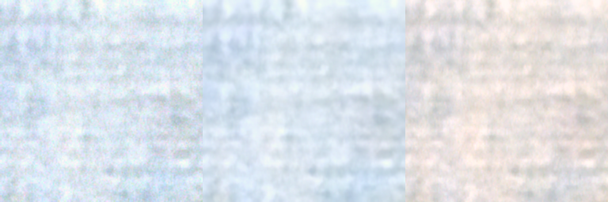
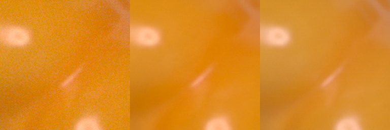

# Failure-case analysis

Model: deployed hybrid student, INT8, blind white balance, on the SIDD-CC test blocks. The panels in
`results/failures/` show naive classical rendering, hybrid output and ground truth, left to right.
The full per-scene table is in `results/failures.json`.

Across scenes, error follows white-balance error more than noise. Best scenes reach 41–42 dB with an AWB
error under 1°; the worst scene has 5.4°. With the true white balance the same network scores 38.61 dB
instead of 35.23 dB, so about 3.4 dB of the average loss comes from colour estimation, not restoration.

## 1. Saturated single-colour block: scene 0020, block 21 (24.60 dB, ΔE 4.24)

**What happens:** a saturated red surface comes out duller than the ground truth.
**Cause:** 27% of the ground-truth channel values are above 0.98, so the target is clipped in red. The AWB
error for this scene is 5.41°, which lowers the red gain. Near clipping, a small gain error shows as a large
per-channel error. The texture itself is clean, so the network is not at fault.
**Mitigation:** use as-shot metadata when present, which the app does for DNG files. Otherwise, a stronger
illuminant estimator would be needed.

## 2. Near-white surface with a colour cast: scene 0020, block 24 (24.65 dB, ΔE 10.44)

**What happens:** a white fabric turns slightly blue.
**Cause:** the same AWB error. White is where the eye and CIEDE2000 are most sensitive to a cast, so this
block has the highest ΔE of the worst six. Statistical AWB also has little to work with when a scene's
blocks are dominated by a few strong colours.
**Mitigation:** as for case 1.

## 3. Low-frequency brightness mismatch: scene 0106, block 20 (25.68 dB, ΔE 2.63)

**What happens:** PSNR is poor but ΔE is fine. Smooth brightness bands differ from the ground truth.
**Cause:** the same band is already visible in the naive rendering of the noisy input, so the network did not
create it. The likely explanation is that this noisy frame differs from the ground-truth burst average, for
example through flicker or small scene changes. We did not confirm this. It shows a limit of PSNR on burst-based
ground truth rather than a restoration failure.
**Mitigation:** none needed in the ISP.

## 4. Very high noise: scene 0050, Nexus 6 (29.92 dB mean, ΔE 6.44)

**What happens:** AWB is good here (1.66°), yet quality is among the lowest.
**Cause:** the noise parameters are the highest of the test set (a = 1.3e-2, b = 1.0e-3). Fine texture sits below
the noise floor, so the network has to choose between keeping grain and smoothing detail. Dark regions also lose
colour accuracy, since the signal is close to zero after black-level subtraction.
**Mitigation:** multi-frame capture, which is outside this single-frame design.

## Other weaknesses seen in robustness tests

- **Forced white-balance error:** a +15% gain error costs the hybrid 3.8 dB because the colour stages trust their
  input. The end-to-end network does not read white balance, so it is unaffected by this particular test.
- **Underexposure by 2 EV:** ΔE is level with classical (5.90 vs 5.94) even though PSNR is 3.4 dB better.
- **Small heavily textured crops:** the noise estimator reads texture as noise. The network ignores the estimate,
  but the classical path and the sharpening strength still use it.
